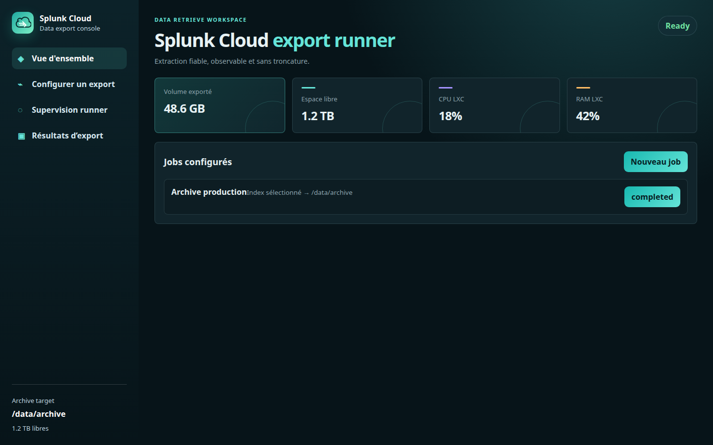
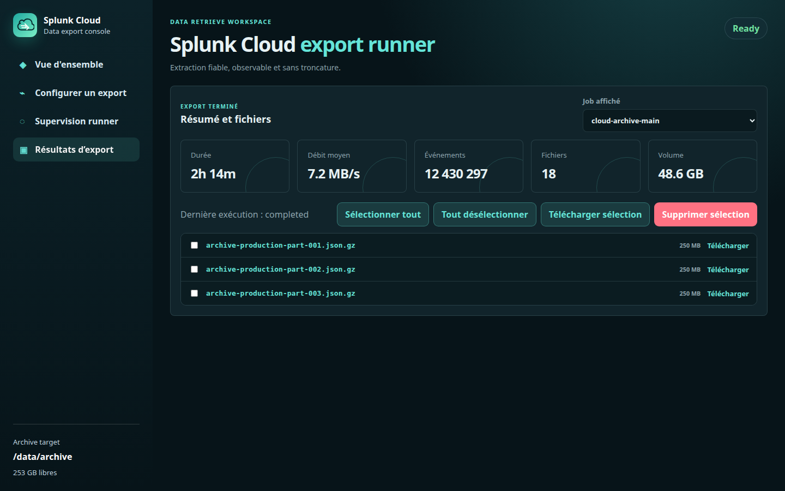

# Advanced Splunk Export Console

Console FastAPI authentifiée pour préparer, lancer et superviser des exports parallèles Splunk Cloud via [`tmuth/splunk-export`](https://github.com/tmuth/splunk-export).



## Fonctionnalités

- Jobs d'export configurables, avec jetons Splunk masqués dans l'interface
- Analyse pré-export et recommandation de partitionnement
- Supervision : état, arrêt contrôlé, journaux, CPU/RAM, réseau RX/TX, débit et progression
- Résultats par job : durée, débit moyen, événements, fichiers, téléchargement individuel ou ZIP
- Sélecteur graphique des volumes/dossiers de stockage
- Nettoyage de l'historique d'un job sans supprimer ses exports
- Récupération des runs orphelins après le redémarrage de la console

## Aperçu de l'interface

Les captures ci-dessous sont des exemples anonymisés : elles ne contiennent ni token Splunk, ni nom d'hôte client, ni fichier réel.

### Vue d'ensemble


### Résultats d'export



## Installation manuelle sur Linux

> L'installation applique aussi un décalage progressif de **20 secondes** entre
> le démarrage de chaque worker. Cela évite que toutes les recherches Splunk et
> tous les téléchargements commencent simultanément.

Cette procédure installe l'application sous `/opt/splunk-cloud-export` et l'expose en HTTP sur le port `8082`. Elle a été validée sur Ubuntu/Debian avec Python 3.9 ou plus récent.

> Avant de commencer, prévoyez un volume de stockage séparé ou suffisamment dimensionné pour les archives. Les exports volumineux peuvent nécessiter beaucoup de disque et de mémoire.

### 1. Prérequis

- Un Linux 64 bits (Ubuntu 22.04/24.04 ou Debian récent recommandé)
- Accès `sudo` et accès Internet sortant vers GitHub/PyPI et Splunk Cloud
- Python **3.9+**, `venv` et `pip`
- Git
- Un point de montage pour les exports, par exemple `/data/archive`
- Un compte/token Splunk Cloud autorisé à lancer les recherches et à accéder au port de management configuré (souvent TCP 8089 en sortie)
- TCP **8082 entrant** uniquement depuis les utilisateurs/réseaux autorisés ; mettez idéalement un proxy HTTPS devant l'application en production

Pour les gros volumes, partez sur au moins 8 Go de RAM et adaptez le partitionnement. Des partitions horaires et 2 workers sont plus sûrs que des partitions journalières avec beaucoup de workers.

### 2. Installer les paquets système

```bash
sudo apt update
sudo apt install -y git python3 python3-venv python3-pip ca-certificates
```

Sur une distribution RPM, installez les équivalents `git`, `python3`, `python3-pip` et `python3-virtualenv`/`python3-venv`.

### 3. Créer le compte de service et les répertoires

```bash
sudo useradd --system --home /opt/splunk-cloud-export --shell /usr/sbin/nologin splunkexport
sudo install -d -o splunkexport -g splunkexport -m 0750 \
  /opt/splunk-cloud-export/{data,configs,runs}
sudo install -d -o splunkexport -g splunkexport -m 0750 /data/archive
```

Si votre volume est déjà monté ailleurs, remplacez `/data/archive` par son chemin dans la commande et plus loin dans `ARCHIVE_PATH`.

### 4. Télécharger la console et le runner amont

```bash
sudo git clone https://github.com/glandygit/advanced-splunk-export.git \
  /opt/splunk-cloud-export/app
sudo git clone https://github.com/tmuth/splunk-export.git \
  /opt/splunk-cloud-export/splunk-export
sudo chown -R splunkexport:splunkexport /opt/splunk-cloud-export
```

### 5. Créer l'environnement Python et installer les dépendances

La console et le runner utilisent le même environnement virtuel.

```bash
sudo python3 -m venv /opt/splunk-cloud-export/venv
sudo /opt/splunk-cloud-export/venv/bin/pip install --upgrade pip wheel
sudo /opt/splunk-cloud-export/venv/bin/pip install \
  -r /opt/splunk-cloud-export/app/requirements.txt \
  -r /opt/splunk-cloud-export/splunk-export/requirements.txt
```

La dépendance `splunk_hec` du runner est importée même si la destination choisie est le système de fichiers. Installez aussi l'adaptateur fourni par ce dépôt :

```bash
sudo install -o splunkexport -g splunkexport -m 0644 \
  /opt/splunk-cloud-export/app/vendor/splunk_hec.py \
  /opt/splunk-cloud-export/splunk-export/splunk_hec.py
```

Les dépendances Python principales sont : `fastapi`, `uvicorn`, `python-multipart`, `psutil`, `splunklib`, `python-dateutil`, `ConfigArgParse`, `tendo`, `smart_open`, `boto3` et `splunk_hec`.

### 6. Configurer les identifiants de la console

Ne mettez pas le token Splunk ici : il est saisi dans l'interface et enregistré localement, sous forme protégée par les permissions du compte de service.

```bash
sudo install -d -m 0750 /etc/splunk-cloud-export
sudo tee /etc/splunk-cloud-export/app.env >/dev/null <<'EOF'
APP_USER=change-me
APP_PASSWORD=replace-with-a-long-random-password
ARCHIVE_PATH=/data/archive
EOF
sudo chown root:splunkexport /etc/splunk-cloud-export/app.env
sudo chmod 0640 /etc/splunk-cloud-export/app.env
```

Choisissez un mot de passe long et unique. Le fichier ne doit jamais être commité ni partagé.

### 7. Installer et démarrer le service systemd

```bash
sudo install -o root -g root -m 0644 \
  /opt/splunk-cloud-export/app/systemd/splunk-cloud-export-8082.service \
  /etc/systemd/system/splunk-cloud-export.service
sudo systemctl daemon-reload
sudo systemctl enable --now splunk-cloud-export
sudo systemctl status splunk-cloud-export --no-pager
```

Le service écoute sur `0.0.0.0:8082`. Vérifiez localement :

```bash
curl -I http://127.0.0.1:8082/
sudo journalctl -u splunk-cloud-export -n 100 --no-pager
```

### 8. Ouvrir le pare-feu de manière limitée

Avec UFW, autorisez uniquement votre IP ou votre réseau d'administration :

```bash
sudo ufw allow from 203.0.113.10 to any port 8082 proto tcp
```

Avec un Security Group AWS, ajoutez une règle entrante TCP 8082 avec une source restreinte (votre IP en `/32`, un VPN ou un bastion). N'ouvrez pas la console à `0.0.0.0/0` sans proxy HTTPS, authentification forte et protection réseau supplémentaire.

### 9. Première connexion et premier export

1. Ouvrez `http://ADRESSE_DU_SERVEUR:8082`.
2. Connectez-vous avec `APP_USER` et `APP_PASSWORD`.
3. Créez un job, renseignez l'hôte Splunk Cloud, le port de management, le token, l'index et la période.
4. Utilisez **Analyser et optimiser** avant les gros exports.
5. Dans **Destination stockage**, choisissez le volume/dossier via **Parcourir**.
6. Lancez un test sur une période courte, puis contrôlez **Supervision runner** et **Résultats d'export**.

Pour limiter le risque mémoire sur des index très actifs, commencez avec des partitions de 1 à 2 heures, 2 workers et des fichiers de 250 Mo. Augmentez progressivement après observation de la mémoire, du réseau et de Splunk Cloud.

## Exploitation

```bash
# État et journaux de la console
sudo systemctl status splunk-cloud-export
sudo journalctl -fu splunk-cloud-export

# Redémarrer la console (ne pas le faire pendant un export actif)
sudo systemctl restart splunk-cloud-export

# Mettre à jour le code puis redémarrer
sudo -u splunkexport git -C /opt/splunk-cloud-export/app pull --ff-only
sudo /opt/splunk-cloud-export/venv/bin/pip install -r /opt/splunk-cloud-export/app/requirements.txt
sudo systemctl restart splunk-cloud-export
```

Les données persistantes sont sous `/opt/splunk-cloud-export/data`, les configurations générées sous `configs`, les journaux de runs sous `runs`, et les archives dans `ARCHIVE_PATH`. Sauvegardez au minimum le répertoire `data` et vos exports si vous devez conserver l'historique.

## Sécurité

- Utilisez un mot de passe unique et un accès réseau restreint.
- Préférez HTTPS derrière Nginx/Caddy ou un équivalent pour tout accès hors réseau de confiance.
- Ne commitez jamais `app.env`, la base SQLite, les tokens, journaux ou archives.
- Le bouton **Effacer l'historique** ne touche jamais aux fichiers exportés ; la suppression d'exports se fait depuis la page **Résultats d'export**, après confirmation.
